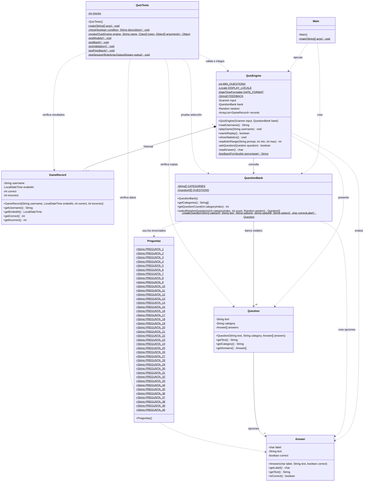

# UML de clases

El diagrama incluye las siete clases del juego y el ejecutor de pruebas. Java genera el constructor público sin argumentos de `Preguntas`. En el código de pruebas, types es Class<?>[] y arguments usa varargs Object..., representado aquí como Object[]. Los métodos de prueba que usan reflexión declaran throws Exception. Los atributos de las clases del juego se declaran con `final`. Los miembros estáticos se indican con el sufijo $ en el código Mermaid. Los modelos inmutables exponen getters y se inicializan mediante sus constructores.
