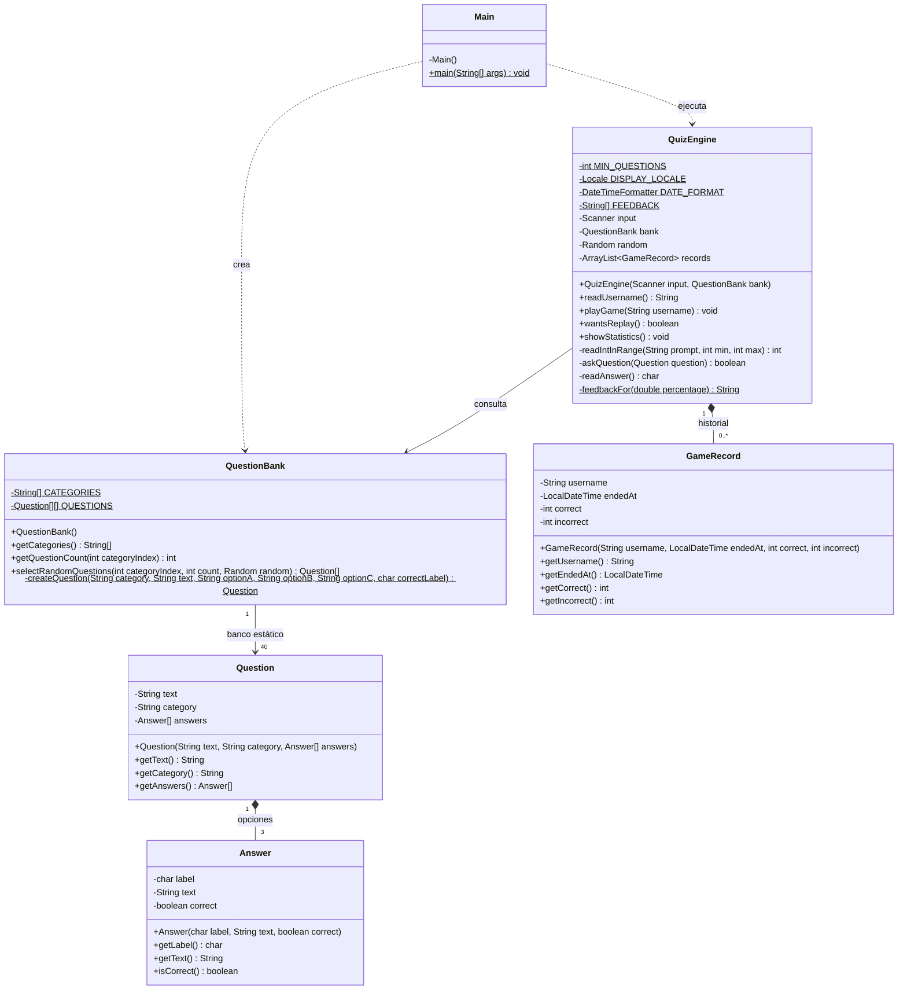
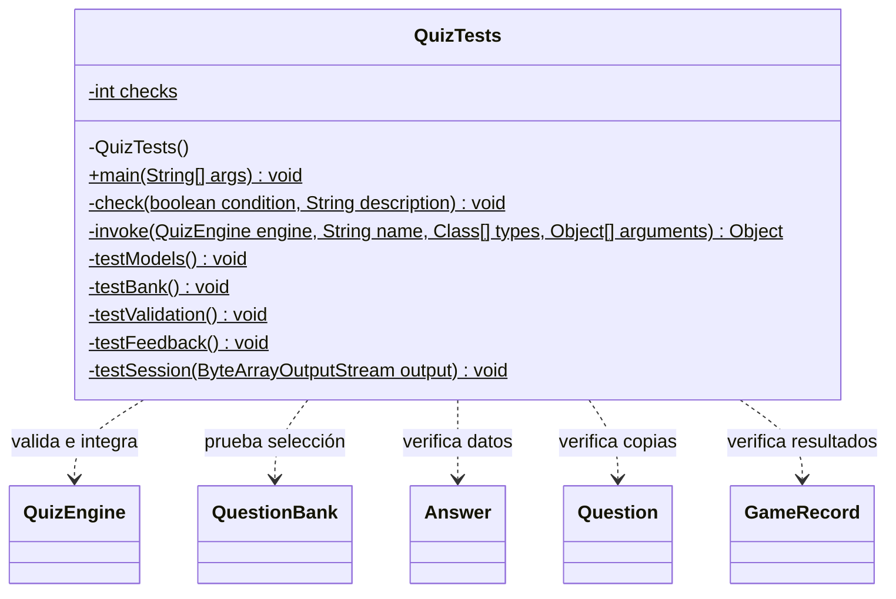

# UML de clases

## Ejecutor de pruebas

En el código de pruebas, types es Class<?>[] y arguments usa varargs Object..., representado aquí como Object[]. Los métodos de prueba que usan reflexión declaran throws Exception. Los atributos del juego son final. Los miembros estáticos se indican con el sufijo $ en el código Mermaid. Los modelos inmutables exponen getters y se inicializan mediante sus constructores.
